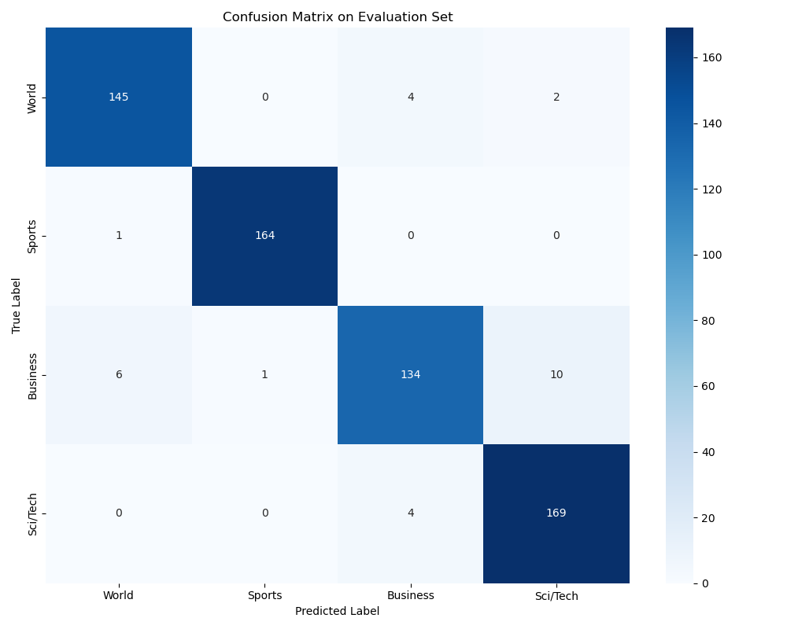
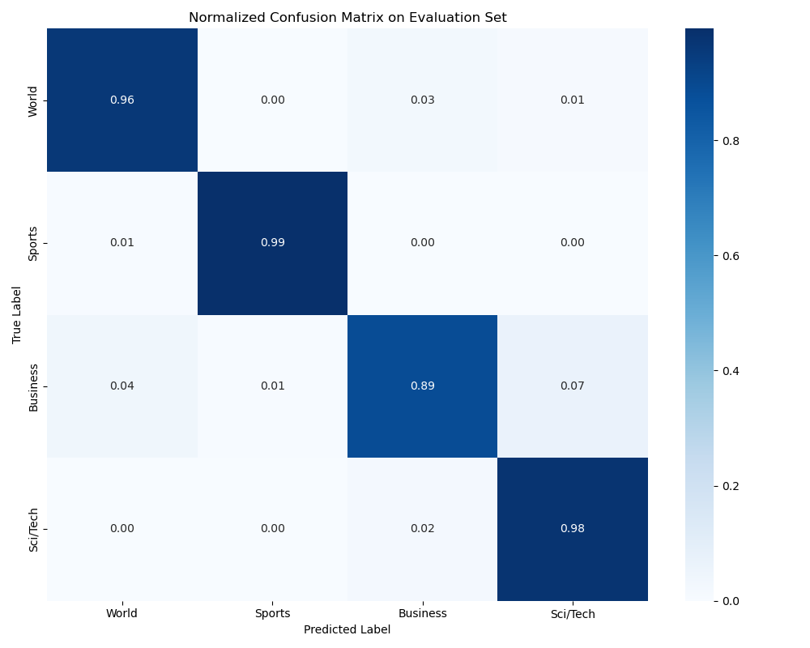
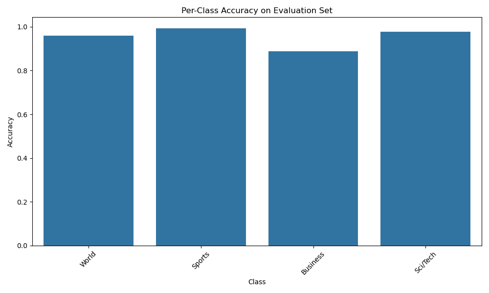
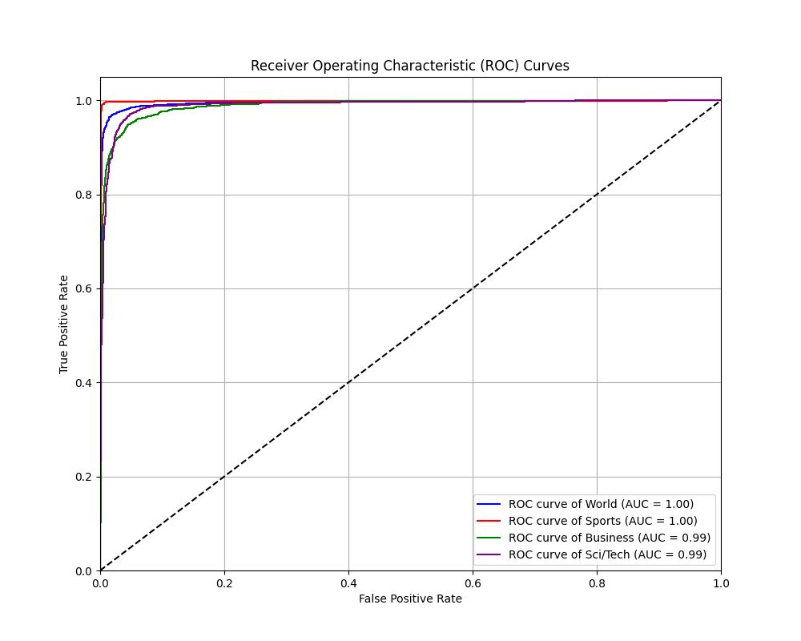
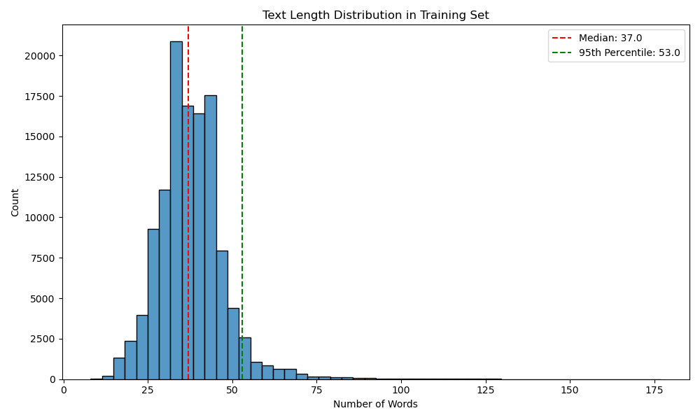

# Parameter-Efficient Fine-Tuning of RoBERTa with LoRA

Parameter-efficient fine-tuning of **RoBERTa-base** for four-class news classification on the **AG News** dataset using Low-Rank Adaptation (LoRA).

The project explores multiple LoRA configurations under a strict **1 million trainable-parameter budget**, then trains and evaluates the strongest valid configuration using Hugging Face Transformers and PEFT.

## Results

| Metric | Result |
|---|---:|
| Evaluation accuracy | **95.625%** |
| Trainable parameters | **814,852** |
| Total parameters | 125,463,560 |
| Trainable share | **0.6495%** |
| LoRA rank | 4 |
| LoRA alpha | 96 |
| LoRA dropout | 0.1 |
| Target modules | query, key, value |

The selected LoRA configuration fine-tunes fewer than **1% of the model's parameters** while reaching **95.625% evaluation accuracy**.

## Model Configuration

The final model uses:

```text
Base model        roberta-base
Task              Sequence classification
Dataset           AG News
Classes           4

LoRA rank         4
LoRA alpha        96
LoRA dropout      0.1
Target modules    query, key, value

Trainable         814,852 parameters
Total             125,463,560 parameters
Trainable share   0.6495%
```

The base RoBERTa parameters remain frozen while LoRA introduces trainable low-rank adaptation matrices into the attention projections.

## LoRA Search

Four LoRA configurations were evaluated against the project requirement of fewer than 1 million trainable parameters.

| Configuration | Rank | Alpha | Target Modules | Trainable Parameters |
|---|---:|---:|---|---:|
| Minimal | 2 | 16 | query | 630,532 |
| Balanced | 3 | 32 | query, value | 704,260 |
| Comprehensive | 4 | 96 | query, key, value | **814,852** |
| Focused Strong | 2 | 128 | query, key, value | 704,260 |

The **comprehensive** configuration was selected because it used the largest trainable capacity while remaining within the parameter budget.

## Training Configuration

```text
Epochs              25
Learning rate       1e-4
Optimizer           AdamW
LR scheduler        Cosine
Warmup ratio        0.15
Weight decay        0.005
Train batch size    48
Eval batch size     64
Gradient accumulation  2
Label smoothing     0.05
Mixed precision     FP16
```

Training used evaluation and checkpointing at the end of each epoch with the best model selected by evaluation accuracy.

The best recorded evaluation accuracy was **95.625%**.

## Evaluation

The final evaluation set contains 640 examples.

Recorded evaluation metrics include:

```text
Accuracy     0.95625
Precision    0.95636
Recall       0.95625
F1           0.95597
```

The notebook also evaluates per-class precision, recall, and F1 for the four AG News categories:

- World
- Sports
- Business
- Sci/Tech

## Visual Analysis

### Confusion Matrix



### Normalized Confusion Matrix



### Per-Class Accuracy



### ROC Curves



### Text Length Distribution



## Technical Approach

The notebook performs the full workflow:

1. Loads the AG News dataset with Hugging Face Datasets.
2. Tokenizes examples for RoBERTa.
3. Examines class and text-length distributions.
4. Filters examples using text-length criteria.
5. Creates a deterministic train/evaluation split.
6. Tests multiple LoRA configurations against the parameter budget.
7. Applies LoRA using Hugging Face PEFT.
8. Fine-tunes RoBERTa with cosine learning-rate scheduling and warmup.
9. Evaluates accuracy, precision, recall, F1, and per-class behavior.
10. Generates confusion matrices and other diagnostic visualizations.
11. Saves the final LoRA adapter separately from intermediate training checkpoints.

## Repository Structure

```text
LoRA-finetune-2025/
├── data/
│   └── test_unlabelled.pkl
│
├── generated_plots/
│   ├── ROC_curve.jpeg
│   ├── eval_confusion_matrix.png
│   ├── eval_normalized_confusion_matrix.png
│   ├── eval_per_class_accuracy.png
│   └── text_length_distribution.png
│
├── reports/
│   └── three_musketeers_LoRa_report.pdf
│
├── saved_model/
│   ├── adapter_config.json
│   ├── adapter_model.safetensors
│   ├── merges.txt
│   ├── special_tokens_map.json
│   ├── tokenizer_config.json
│   └── vocab.json
│
├── .gitignore
├── README.md
├── requirements.txt
├── results.json
└── script.ipynb
```

Intermediate Trainer checkpoints are intentionally excluded from the current repository tree. The final LoRA adapter remains available under `saved_model/`.

## Setup

Clone the repository:

```bash
git clone https://github.com/fzinnah17/LoRA-finetune-2025.git
cd LoRA-finetune-2025
```

Create a virtual environment:

```bash
python3 -m venv .venv
source .venv/bin/activate
```

Install dependencies:

```bash
pip install -r requirements.txt
```

Start the notebook:

```bash
jupyter notebook script.ipynb
```

The AG News training dataset is retrieved through the Hugging Face `datasets` library.

## Saved Adapter

The final PEFT adapter is stored in:

```text
saved_model/
```

Its configuration specifies:

```text
base model     roberta-base
PEFT type      LoRA
rank           4
alpha          96
dropout        0.1
targets        query, key, value
task           sequence classification
```

## Reproducible Results

Verified headline metrics are also stored in:

```text
results.json
```

This provides a compact record of the final model configuration and evaluation result without requiring intermediate training checkpoints.

## Project Report

The original project report is available at:

```text
reports/three_musketeers_LoRa_report.pdf
```

## Team

- Chinmay Shringi
- Farnaz Zinnah
- Mohd Sarfaraz Faiyaz

## Acknowledgments

This project was completed using Hugging Face Transformers, PEFT, PyTorch, and computational resources provided by NYU.
