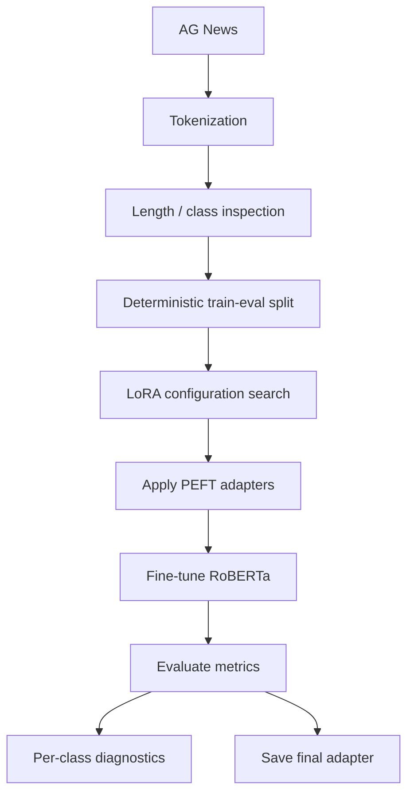

# Parameter-Efficient Fine-Tuning of RoBERTa with LoRA

> **FZ / PEFT DOSSIER 01**  
> RoBERTa-base · AG News · Low-Rank Adaptation · Sub-1M trainable-parameter constraint

A parameter-efficient fine-tuning study for four-class news classification using **RoBERTa-base** and **LoRA**.

The project explores multiple LoRA configurations under a strict **1,000,000 trainable-parameter ceiling**, then trains and evaluates the strongest valid configuration using Hugging Face Transformers and PEFT.

---

## SYSTEM RECORD

| | |
| --- | --- |
| **Base model** | `roberta-base` |
| **Task** | 4-class sequence classification |
| **Dataset** | AG News |
| **Evaluation accuracy** | **95.625%** |
| **Trainable parameters** | **814,852** |
| **Total parameters** | 125,463,560 |
| **Trainable share** | **0.6495%** |
| **LoRA rank** | `4` |
| **LoRA alpha** | `96` |
| **LoRA dropout** | `0.1` |
| **Targets** | query · key · value |

---

## 01 / PARAMETER-EFFICIENCY FIELD

```text
TOTAL PARAMETERS      125,463,560
TRAINABLE PARAMETERS      814,852
TRAINABLE SHARE              0.6495%
PARAMETER CEILING         1,000,000
```

```text
FULL MODEL
██████████████████████████████████████████████████  125.46M

TRAINABLE LoRA SHARE
▎                                                     0.815M
```

Fewer than **1%** of model parameters are trainable in the selected configuration.

---

## 02 / ARCHITECTURE


The base model remains frozen while trainable low-rank adapters are introduced into the attention projections.

```text
ATTENTION PROJECTION

frozen weight
     │
     ├──────────────► base transformation
     │
     └──► A · B ───► low-rank adaptation
                       │
                       ▼
                 combined output
```

---

## 03 / LoRA SEARCH

| Configuration | Rank | Alpha | Target Modules | Trainable Parameters |
| --- | ---: | ---: | --- | ---: |
| Minimal | 2 | 16 | query | 630,532 |
| Balanced | 3 | 32 | query, value | 704,260 |
| Comprehensive | **4** | **96** | **query, key, value** | **814,852** |
| Focused Strong | 2 | 128 | query, key, value | 704,260 |

The **Comprehensive** configuration uses the largest trainable capacity of the tested candidates while remaining below the one-million-parameter ceiling.

---

## 04 / TRAINING PROFILE

```text
EPOCHS                  25
LEARNING RATE           1e-4
OPTIMIZER               AdamW
SCHEDULER               Cosine
WARMUP RATIO            0.15
WEIGHT DECAY            0.005
TRAIN BATCH             48
EVAL BATCH              64
GRADIENT ACCUMULATION   2
LABEL SMOOTHING         0.05
MIXED PRECISION         FP16
```

Evaluation and checkpointing occur at the end of each epoch, with the best model selected by evaluation accuracy.

---

## 05 / VERIFIED EVALUATION

The final evaluation set contains **640 examples**.

| Metric | Result |
| --- | ---: |
| Accuracy | **0.95625** |
| Precision | **0.95636** |
| Recall | **0.95625** |
| F1 | **0.95597** |

The best recorded checkpoint was at **epoch 13**.

---

## 06 / VISUAL EVIDENCE

### Confusion Matrix


### Normalized Confusion Matrix


### Per-Class Accuracy


### ROC Curves


### Text Length Distribution


---

## 07 / PIPELINE



---

## 08 / CLASSIFICATION TARGETS

```text
0  WORLD
1  SPORTS
2  BUSINESS
3  SCI / TECH
```

Per-class precision, recall, F1, and accuracy diagnostics are included in the notebook-generated analysis.

---

## 09 / REPOSITORY MAP

```text
LoRA-finetune-2025/
├── data/
│   └── test_unlabelled.pkl
├── generated_plots/
│   ├── ROC_curve.jpeg
│   ├── eval_confusion_matrix.png
│   ├── eval_normalized_confusion_matrix.png
│   ├── eval_per_class_accuracy.png
│   └── text_length_distribution.png
├── reports/
│   └── three_musketeers_LoRa_report.pdf
├── saved_model/
│   ├── adapter_config.json
│   ├── adapter_model.safetensors
│   ├── merges.txt
│   ├── special_tokens_map.json
│   ├── tokenizer_config.json
│   └── vocab.json
├── requirements.txt
├── results.json
├── script.ipynb
└── README.md
```

Intermediate Trainer checkpoints are excluded. The final LoRA adapter is retained under `saved_model/`.

---

## 10 / RUN LOCALLY

```bash
git clone https://github.com/fzinnah17/LoRA-finetune-2025.git
cd LoRA-finetune-2025

python3 -m venv .venv
source .venv/bin/activate
pip install -r requirements.txt

jupyter notebook script.ipynb
```

The AG News training dataset is retrieved through the Hugging Face `datasets` library.

---

## 11 / TEAM

Developed by:

**Farnaz Zinnah**  
**Chinmay Shringi**  
**Mohd Sarfaraz Faiyaz**

---

<div align="center">

**FZ / NLP · PEFT · MODEL EFFICIENCY**

`ROBERTA-BASE / LoRA / 95.625% EVALUATION ACCURACY`

</div>
